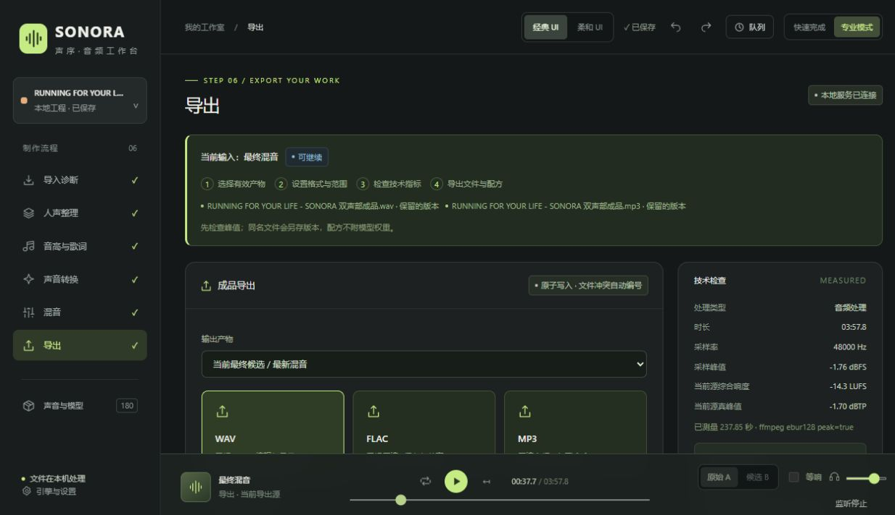

# 声序 SONORA

面向 **语音变声、歌曲翻唱与改词制作** 的本地音频工作台，集成人声分离、音高编辑、声音生成、试听验收、混音与导出。

[下载便携版](https://github.com/BF-2/SONORA/releases/latest) · [一键准备说明](docs/portable-setup.md)

## 主界面参考

| 经典界面 · 深色 | 柔和界面 · 浅色 |
| :---: | :---: |
|  |  |

两版界面共用工程、音轨与编辑状态，可随时切换。

## 重点功能

| 功能 | 重点能力 |
| --- | --- |
| 人声分离 | 两级分离：伴奏 / 人声 → 主唱 / 和声；分离结果独立管理 |
| 音高编辑 | 曲线绘制与擦除、音符与 MIDI、独立编辑版本、撤销与重做 |
| 声音制作 | RVC 变声与翻唱、Hay Say M6 六角色声库、导唱录制、日语歌词合成 |
| 试听与验收 | A/B 等响对比、候选版本比较、接受与重试、Final List 成品库 |
| 多轨混音 | 音量、声像与时间偏移；人声厚度修复；C / C+ / C++ 空间效果 |
| 成品导出 | WAV / FLAC / MP3、分轨输出、工程配方保存 |
| 一键准备 | 自动安装 Python 与缺失依赖；源站 / 镜像切换；基础模型与 M6 RVC + index 下载选项 |
